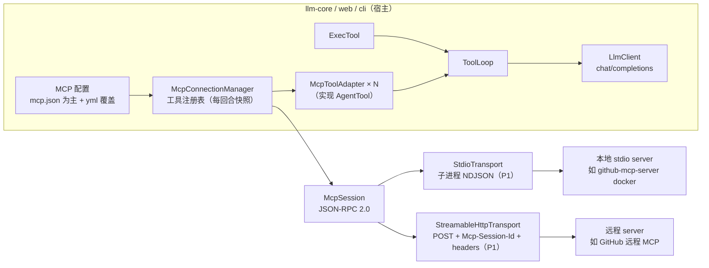

# MCP Support（LLM 后端接入 Model Context Protocol）

## [S1] Problem

`llm-core` 已具备完整的 function-calling 链路（`AgentTool` / `ToolSpec` / `ToolLoop`，含流式 `tool_calls` 聚合、最多 8 轮工具回灌），但可用工具只有内置的 `exec`。MCP（Model Context Protocol）已是工具生态的事实标准——浏览器自动化、文件系统、数据库、各类 SaaS 都以 MCP server 形式发布，而后端一个都接不进。

目标：让后端 LLM（`cli` 与 `web` 共用的对话链路）能连接 MCP server，把远端工具纳入模型可调用的工具集，同时不破坏现有 exec 工具、记忆压缩、SSE 流式契约与持久化行为。

接入面两类都是硬需求，参照 [github-mcp-server](https://github.com/github/github-mcp-server) 的形态：

- **本地 stdio**（如 `docker run -i --rm ghcr.io/github/github-mcp-server`，凭据走环境变量）；
- **远程 Streamable HTTP**（如 GitHub 远程 MCP `https://api.githubcopilot.com/mcp/`，凭据走 `Authorization: Bearer <PAT>` 请求头）。

后端会部署在 **PC / 桌面环境**（也有服务器形态），因此远程鉴权**两条都必须支持**：

- **静态 headers（PAT / Bearer token）**——配置即用，适合服务端与自动化；
- **OAuth**——授权码 + PKCE、拉起系统浏览器登录（PC 部署天然可行，VS Code / Claude Desktop 同款体验），device code 兜底无浏览器环境。GitHub 托管版远程 MCP 的 OAuth 形态在验收范围内。

本方案解决的是 **MCP client / 宿主** 方向（agent 消费 MCP server 的 tools）。反方向——把 agent 自身暴露为 MCP server——列入 [S3]，不在本期。

## [S2] Design

### [S2.1] 总体思路：MCP 工具适配为 AgentTool

现有 `AgentTool` 就是为这类扩展准备的接口：

```java
String name(); String description(); String parametersJson();
String execute(String argumentsJson);   // 失败以文本返回，不抛异常
```

MCP 的 `tools/list` 恰好给出 `name / description / inputSchema`，`tools/call` 恰好是「进 arguments、出内容文本」。因此核心工作是做一个薄适配层：

- `tools/list` → `ToolSpec`（喂给 `LlmClient.complete/completeStream` 的 `tools` 数组）
- `tools/call` → `AgentTool.execute`（结果回灌 `role:"tool"` 消息）

`ToolLoop` 的工具循环、多轮回灌、未知工具报错、maxRounds 兜底**全部直接复用**，不需要理解 MCP。



### [S2.2] 包布局：`llm-core` 新增 `dev.kualu.mcp`

| 类 | 职责 |
|---|---|
| `McpServerConfig` | 单个 server 配置：name、transport、stdio（command/args/env）或 http（url/headers）、超时、启用开关 |
| `McpTransport` | 传输抽象：发送一条 JSON-RPC 消息、按到达顺序取消息、关闭 |
| `StdioTransport` | 子进程 stdio，NDJSON（一行一条 JSON-RPC）；stderr → slf4j；进程退出即断连 |
| `StreamableHttpTransport` | POST 单端点 + `Mcp-Session-Id` 会话头 + 鉴权头注入，响应为 JSON 或 SSE |
| `McpAuth` | 鉴权 SPI：`StaticHeaders`（PAT/Bearer）/ `AuthorizationCodePkce`（浏览器 + loopback 回调）/ `DeviceCode`（兜底） |
| `McpTokenStore` | token 持久化：文件（PC 默认）/ 内存 / Postgres（web） |
| `McpSession` | JSON-RPC 会话：id→future 请求关联、`initialize` 握手与版本协商、notification 分发、`ping` |
| `McpRemoteTool` | 远端工具描述（原名、description、inputSchema） |
| `McpToolAdapter` | 实现 `AgentTool`：命名空间、`tools/call`、结果归一、错误→文本 |
| `McpConnectionManager` | 连接与注册表：启动连接、工具发现/刷新、退避重连、向 `ToolLoop` 供工具快照 |

落点选 `llm-core` 而非新模块：依赖面（Gson、`dev.kualu.http`、`AgentTool`）与现有代码同源，`cli`/`web` 已依赖 `llm-core`，JPMS 只需在 `module-info.java` 里 `exports dev.kualu.mcp`。若将来要单独发布纯协议库再拆模块（备选，见已决事项）。

### [S2.3] 协议与传输

**JSON-RPC 子集自研**（复用 Gson），覆盖 request / response / notification / error object 与流式分片重组。不引官方 java-sdk 的理由见「已决事项」。

生命周期（各版本一致）：

1. `initialize`：携带 `protocolVersion`、`capabilities`、`clientInfo{name:"dev.kualu.agent"}`；
2. server 回包选定 `protocolVersion` 并声明 capabilities（含 `tools.listChanged`）；
3. 客户端发 `notifications/initialized`；
4. 之后即可 `tools/list` / `tools/call` / `ping`。

版本协商覆盖已实现的 revision 集合（`2024-11-05`、`2025-03-26`、`2025-06-18` 及更新，注意真实 server 已在使用 `2026-07-28` 这类新 revision 的 structuredContent 行为）：客户端以最高支持版本发起，server 回什么就按什么方言说；server 选定的版本若在支持集之外，明确报错拒连而不是猜行为。

**stdio**（P1）：`ProcessBuilder` 启动；stdin 写入加锁（多回合可能并发）、stdout 按行读、stderr 转日志；子进程退出即标记断连。典型形态：`docker run -i --rm …`，凭据走 `env`（如 `GITHUB_PERSONAL_ACCESS_TOKEN`）。

**Streamable HTTP**（P1，远程接入主路径）：

- POST 到 endpoint：`Content-Type: application/json`，`Accept: application/json, text/event-stream`；请求体即 JSON-RPC 消息。
- 响应两种形态都要处理：`application/json` 单条消息，或 `text/event-stream`（SSE `event: message` / `data: …`）；`202 Accepted` 表示通知已收到、无响应体。
- **会话**：初始化响应若带 `Mcp-Session-Id`，后续请求必须携带；收到 `404` 视为会话过期，重新 `initialize` 后重试当前调用一次。
- **鉴权**：静态 headers（`Authorization: Bearer <PAT>` 等），值支持 `${ENV}` 占位注入。参照 github-mcp-server 远程版的接入面（url + Bearer PAT 即可工作）。
- server 主动推送（GET SSE 流）与 `DELETE` 会话终止**不做硬依赖**：无 GET 流时收不到 `list_changed` 通知，用周期性重列 + 按需刷新补偿；放 P2/P3。

### [S2.4] 鉴权：静态 headers 与 OAuth（PC 形态为主）

mcp.json 条目语义与生态一致：带 `headers` 的远程条目走静态 token（PAT / Bearer）；不带 `headers` 的 `type:"http"` 走 OAuth（可用 `auth: "oauth"` / `"headers"` 显式覆盖）。

**OAuth 流程**（MCP 授权规范，PC / 桌面部署为主）：

1. 请求得到 `401` + `WWW-Authenticate: Bearer resource_metadata="…"` → 拉取受保护资源元数据（RFC 9728）→ 定位授权服务器元数据（RFC 8414）；
2. 客户端身份：优先配置自带 `client_id`（自建 GitHub App / OAuth App 形态），否则动态客户端注册（RFC 7591）；
3. **授权码 + PKCE（S256）**：拉起系统浏览器登录，loopback 回调 `http://127.0.0.1:<port>`——PC 部署天然可行（VS Code / Claude Desktop 同款体验）；授权完成本机收码换 token；
4. 后续请求带 `Authorization: Bearer <access_token>`；`refresh_token` 自动续期；刷新失败回到第 1 步重新登录；
5. **device code 兜底**：拿不到浏览器回调的环境（远程桌面 / 服务器）展示用户码 + 轮询授权。

**Token 持久化**（`McpTokenStore` SPI）：PC 默认存用户配置目录的本地文件（权限收紧）；刷新令牌必须持久化，否则每次重启都重登；`agent.store=memory` 轻部署同样可用，web 服务端可落 Postgres。token 与密钥永不进日志。

**实现边界**：OAuth 流程编排（RFC 9728/8414 发现、RFC 7591 动态注册、RFC 8252 loopback 回调、RFC 8628 设备授权、token 刷新）实现于 `dev.kualu.mcp.auth`，封装在 `McpAuth` SPI 之后；PKCE 用标准 S256 构造（SHA-256 + base64url）。原计划引 Nimbus oauth2-oidc-sdk，实测其 jar 无 `Automatic-Module-Name`、无法被 JPMS 模块 `dev.kualu.agent` 引用，遂自研上述构造（见已决事项）。将来若整换官方 java-sdk，SPI 边界不变。

### [S2.5] 工具桥接（`McpToolAdapter`）

- **命名**：对外名字 `mcp_<server>_<tool>`，清洗为 `[A-Za-z0-9_-]`（OpenAI 函数名约束 `^[a-zA-Z0-9_-]{1,64}$`）；超 64 字符截断并附 4 位 hash 后缀防撞。`tools/call` 发给 server 的仍是**原始工具名**，映射保存在 adapter 内。server 重名在配置加载时拒绝。
- **description**：远端描述 + 标注 `MCP tool: <server>/<tool>`，让模型知道来源与真实名字。
- **parametersJson**：远端 `inputSchema` 原样透传。
- **execute** → `tools/call {name: 原名, arguments}`，结果归一：
  - `text` blocks 依次拼接；
  - `image` / `audio` / `resource` blocks → 占位文本（如 `[image omitted: image/png]`），本期不进上下文；
  - 有 `structuredContent` 则附一段 JSON；
  - `isError: true` → 前缀 `error: ` 返回；
  - 超时 / 断连 / 未知工具 → `error: ...` 文本。**一律不抛异常**，与 `AgentTool` 契约（失败以结果文本让模型反应）一致。
- **防护**：单次调用超时（默认 60s，可按 server 覆盖）；结果截断（默认 8000 字符，对齐 exec 的 output-limit）防上下文淹没。

### [S2.6] 生命周期、动态工具与 ToolLoop 微调

- **启动**：逐 server 连接 → 握手 → `tools/list` → 注册适配器。任一步失败只 WARN 并跳过——**不注册死工具**，模型看不到比看到却必错好。
- **`notifications/tools/list_changed`**（server 声明支持时）→ 重拉该 server 的 `tools/list`，替换其工具集。
- **重连**：stdio 子进程退出 → 下架该 server 工具、指数退避重连（封顶，如 5 分钟）；期间调用其工具返回断连错误文本。
- **ToolLoop 微调**：新增 `Supplier<List<AgentTool>>` 构造重载，每次 `run()` 取快照重建 name→tool 映射（原 `List` 构造委托固定 supplier）。效果：MCP 工具上下线对**下一回合**即生效，无需重启；回合中途刷新不翻车（快照语义）。
- **接线**：`ChatService`、`ChatConsole` 改为持有工具 supplier（`ExecTool` + MCP 工具合成），其余逻辑不动。
- **并发**：一个 `McpSession` 进程级共享（JSON-RPC 按 id 关联，stdio 写加锁）；单回合内工具轮次保持串行（现状不变）。

### [S2.7] 配置

**主配置是 `mcp.json`**（与 Claude Desktop / VS Code / Claude Code 生态同款），服务默认读工作目录 `./mcp.json`，`AGENT_MCP_CONFIG` 可改路径：

```json
{
  "mcpServers": {
    "github": {
      "type": "http",
      "url": "https://api.githubcopilot.com/mcp/",
      "headers": { "Authorization": "Bearer ${GITHUB_PAT}" }
    },
    "playwright": {
      "command": "npx",
      "args": ["@playwright/mcp@latest"],
      "env": { "PLAYWRIGHT_BROWSER": "chromium" }
    }
  }
}
```

- **格式兼容**：顶层键接受 `mcpServers`（Claude 系）与 `servers`（VS Code 系）；stdio 条目 `{command, args, env}`，远程条目 `{type:"http", url, headers}`（带 `command` 且无 `type` 视为 stdio）；远程条目可显式 `auth: "oauth" | "headers"`，缺省时有 `headers` 走静态 token、无则 OAuth（生态同款语义）。`type:"sse"` 老方言条目**加载时明确报错拒绝**，不静默跳过。
- **占位符**：`${ENV}` 从环境变量注入；VS Code 的 `${input:…}` 交互输入在无头后端改为要求同名环境变量（如 `INPUT_GITHUB_MCP_PAT`），缺失则启动失败并指明缺哪一项。
- **yml 内联是部署级覆盖层**：`agent.tools.mcp.servers` 可补充或覆盖 mcp.json 同名条目（同名以内联为准）——mcp.json 是随仓库共享的主声明，yml/env 是部署差异位；server 全写在 mcp.json、yml 不列也完全合法。
- CLI 与 web **同步接入**：共用同一 `McpConnectionManager` 与同一配置来源（mcp.json + yml 覆盖 + env / `.env`）；P2 加 `/tools` 控制台命令查看当前工具集。
- **密钥**：headers 仅支持 `${ENV}` 占位注入；含密钥的 mcp.json 必须 gitignore；启动日志只打印 server 名与 transport 类型，不打印 headers / env 值。

web `application.yml` 中的覆盖位（env 入口沿用现有命名风格）：

```yaml
agent:
  tools:
    mcp:
      enabled: ${AGENT_MCP_ENABLED:true}
      config: ${AGENT_MCP_CONFIG:./mcp.json}   # 主配置文件
      default-timeout-seconds: ${AGENT_MCP_TIMEOUT:60}
      output-limit: ${AGENT_MCP_OUTPUT_LIMIT:8000}
      servers: []                              # 可选：补充/覆盖 mcp.json 同名条目
```

### [S2.8] 流式（SSE）与超时的相互作用

- 工具执行发生在两段模型调用之间，HTTP 响应的 SSE 流保持打开——与现有 exec 行为一致，期间没有 `delta` 是预期的。
- **检查项**：`IdleWatchdog`（`llm.idle-timeout-seconds`，默认 90s）应只监视单次 LLM 流的静默，不应把工具执行计入静默时间；实现时若发现 watchdog 覆盖整个响应，需把工具执行时长从静默计时中扣除（或在工具执行期间发送心跳事件）。
- P2 增强：SSE 增发 `tool` 事件（`{"tool": "mcp_playwright_navigate", "status": "started|finished|failed"}`），前端可显示工具活动。事件是 additive 的，旧客户端忽略即可。

### [S2.9] 安全

- stdio server 是**本地子进程**，信任面与 `exec` 同级：README 的安全注记扩展到 MCP——网关只对可信用户开放；server 清单只能来自操作者配置，模型无法增删 server。
- 远程 server 是**第三方服务**：工具结果视为不可信输入（工具返回的文本会进模型上下文，注意 prompt injection 面）；URL / headers 只来自配置，模型不可指定（无注入面、无 SSRF 面）。
- 远程 URL 强制 **HTTPS**（loopback 豁免），与数据库 URL 的 TLS 白名单同一哲学——凭据（PAT）不得走明文。
- 超时 + 输出截断防挂死与上下文淹没。
- 含密钥的 `mcp.json` 应 gitignore（与 `.env` 同规）。
- **OAuth token**：落盘权限收紧（用户私有目录），refresh token 视同 API key 级凭据；回调只绑 loopback，`state` + PKCE 防 CSRF/码截获；token 永不进日志。
- 日志不打印 `tools/call` 的完整 arguments（可能含敏感输入），只记 server / 工具 / 耗时 / 结果长度。

## [S3] Out of Scope

- 把 agent 暴露为 MCP server（对外提供本 agent 的工具/会话）——后续独立方案。
- MCP resources / prompts 协议面（本期只做 tools）。
- `tools/call` 多模态结果回灌（图片进上下文）——P3 评估。
- 按终端用户隔离 MCP 连接（连接进程级共享；当前部署形态是单租户 localhost 网关）。

## Tasks

- [x] P1.1 `McpSession`：JSON-RPC 消息模型、请求关联、`initialize` 握手、版本协商、notification 分发
- [x] P1.2 `StdioTransport`：子进程、NDJSON、stderr→日志、写锁、退出侦测
- [x] P1.3 `StreamableHttpTransport`：POST 往返（JSON / SSE 双响应形态）、`Mcp-Session-Id` 会话、404 重建会话重试、静态 headers（`${ENV}` 注入）、HTTPS 强制
- [x] P1.4 `McpToolAdapter`：命名清洗与映射、内容归一、错误→文本、超时、截断
- [x] P1.5 `McpConnectionManager`：启动连接（两类 transport）、工具发现、list_changed / 周期刷新、退避重连、supplier API
- [x] P1.6 `ToolLoop` supplier 重载 + 回合内快照；`ChatService` / `ChatConsole` 接线
- [x] P1.7 配置：`mcp.json` 主配置加载器（`mcpServers`/`servers` 双顶层键、`${ENV}`/`${input:…}` 占位、坏条目与老方言报错）+ web `McpProperties` 覆盖层 + env / `.env`；CLI 与 web 同步接线
- [x] P1.8 测试固件：进程内假 MCP server（stdio + 可编程 HTTP 端点）；用例覆盖握手、版本协商、工具发现、调用回灌、isError / 超时 / 断连文本、命名清洗与撞名、会话过期重建、SSE 响应形态、list_changed 刷新、web SSE 链路 smoke
- [x] P1.9 `McpAuth` SPI + `StaticHeaders`（PAT / Bearer）注入 transport
- [x] P1.10 OAuth：元数据发现（RFC 9728 / 8414）、授权码 + PKCE + loopback 回调（拉起系统浏览器）、token 交换与刷新、DCR 与自带 `client_id`
- [x] P1.11 `McpTokenStore`（文件 / 内存 / Postgres）+ 401 挑战触发登录与重试 + device code 兜底
- [x] P1.12 README：配置表补充 + 安全注记（本地进程信任面 / 远程第三方信任面 / HTTPS / token 存储）
- [ ] P1.13 验收链路：浏览器 OAuth 登录 GitHub 托管版远程 MCP 跑通一次真实会话
- [ ] P2.1 SSE `tool` 状态事件 + CLI `/tools` 命令
- [ ] P2.2 GET 通知流（server 主动推送）与 `DELETE` 会话终止

## 已决事项（原「待确认」）

- **JSON-RPC / MCP 协议层自研 vs 官方 java-sdk**（2026-11-05 三轮复核）：协议子集**维持自研**（Gson 复用，所需方法面仅 `initialize` / `tools/list` / `tools/call` / `ping`，混入 Jackson 得不偿失）。
- **OAuth 库的最终形态**（2026-11-05 实测更新）：原定引 Nimbus oauth2-oidc-sdk（11.38.2）封装在 `McpAuth` 后，实测该 jar **无 `Automatic-Module-Name`**，JPMS 的 llm-core（`dev.kualu.agent`）无法引用（javac：「包已在未命名模块中声明」），除非强制整个依赖树上 module path 或把 OAuth 拆出非模块层——命中既定重估条款「Nimbus 集成成本超预期」。最终：**PKCE S256（SHA-256+base64url 标准构造）与授权 URL 组装自研**（约四十行，非密码学协议设计），流程编排本就自研，token 交换走既有 `HttpClient`。再评估整换 java-sdk 的触发条件：需要 SDK 生态互通测试对齐、或旧 HTTP+SSE 方言进范围。
- **OAuth 必须支持**（2026-11-05 用户定）：授权码 + PKCE（浏览器 + loopback 回调）为主路径，device code 兜底；自带 `client_id` 与动态客户端注册都支持；refresh token 必须持久化（`McpTokenStore`，文件默认）。
- **PC / 桌面部署形态**（2026-11-05 用户定）：部署环境含 PC，可拉起系统浏览器完成登录；token 默认落用户配置目录（权限收紧）；不强制 Postgres（`agent.store=memory` 轻部署同样成立）。
- **包落 llm-core vs 新模块**：采纳 llm-core 新包 `dev.kualu.mcp`。纯协议库拆模块的收益要到「对外发布 MCP client」时才出现。
- **2026-11-05 需求输入**（用户确认）：远程 MCP server 是硬需求（参照 github-mcp-server：Streamable HTTP + `Authorization: Bearer <PAT>`，本地 stdio/docker 凭据走 env）；方言以 Streamable HTTP 为主（旧 HTTP+SSE 不进范围）；stdio 与 HTTP **两类都要**。据此：Streamable HTTP 提进 P1，鉴权按静态 headers 设计。
- **自研结论维持**（远程前提下复核）：github-mcp-server 远程版的 PAT 形态只需 url + headers，不涉及 OAuth/设备码，自研成本仍收敛在 POST 往返 + 会话头；OAuth 进范围后的重估结论见上条。
- **server 配置来源**（2026-11-05 定）：以 `mcp.json` **为主**（默认 `./mcp.json`，`AGENT_MCP_CONFIG` 改路径；兼容 `mcpServers`/`servers` 顶层键与 stdio / `type:"http"` 两种条目）；yml 内联降为部署级覆盖层，同名以内联为准。
- **P1 接入面**（2026-11-05 定）：CLI 与 web **同步接入**，共用同一 `McpConnectionManager` 与同一配置来源。
