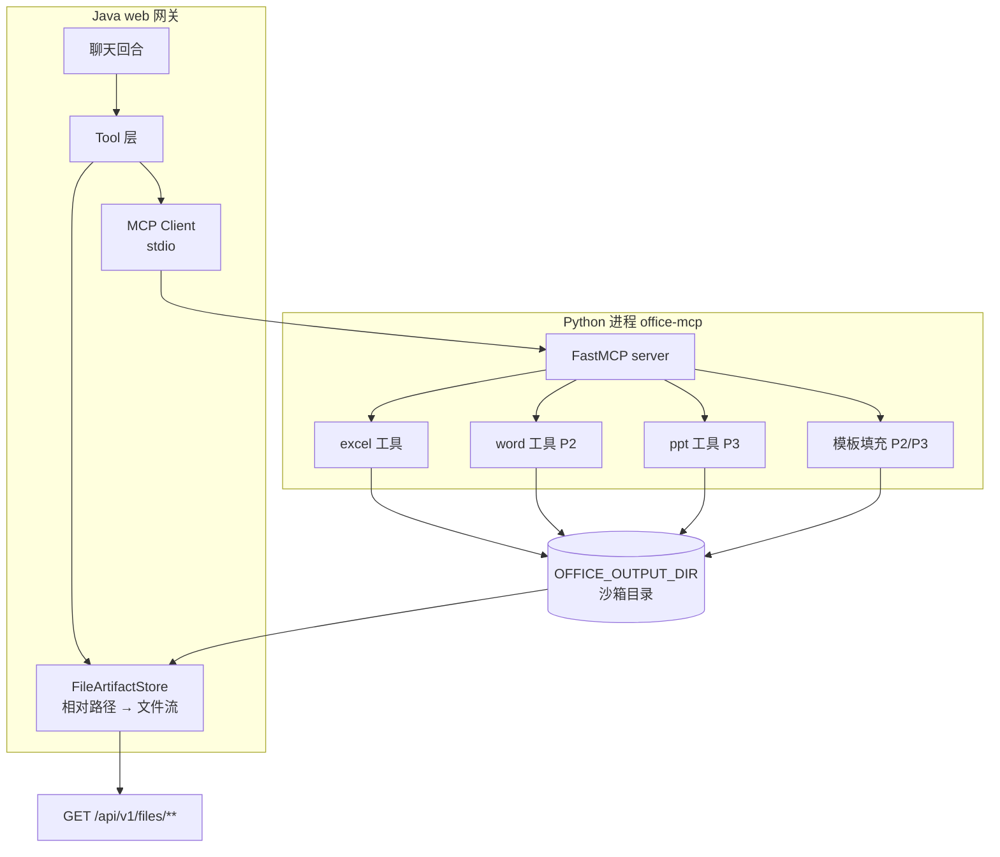

# Office Document Generation（Excel / Word / PPT 生成）

## [S1] Problem

对话链路目前只能产出文本：用户要一份 Excel、Word 报告或 PPT 时，模型无路可走（exec 现写脚本不稳定、不可测、攻击面大）。目标是让 web/cli 的 LLM 能**生成可下载的 Office 文件**，且：

- 工具面固定可测（不让模型每次现写生成代码）；
- 生成的文件能变成登录用户的下载链接；
- 生成能力可独立部署、独立升级，将来能从「本地子进程」平移到「独立服务器」。

技术选型在 2026-11-15/16 讨论定案：**Python + 本地 stdio MCP**（server 用 FastMCP；Java 侧零改动接入已有 MCP client），Java 只补一层「文件路径 → 下载 URL」。备选的 Java 原生（POI）与第三方 MCP（excel-mcp-server / GongRzhe 系列 / opendocswork-mcp）比较结论见「已决事项」。

## [S2] Design

### [S2.1] 总体思路：固定工具面 + 输出目录沙箱 + 独立文件层



三层工具面（控制工具总数 ≤ 25，避免撑爆模型上下文）：

1. **批量入口**（优先引导模型使用）：`xlsx_from_rows` / `build_docx_from_outline` / `build_pptx_from_outline`——一次调用产出完整文件；
2. **声明式细粒度**：写格、格式、图表、合并单元格 / 段落、表格、图片 / 文本框、图表页；
3. **模板填充**：`fill_docx_template` / `fill_pptx_template`（Jinja 占位符，模板放 `OFFICE_TEMPLATES_DIR` 只读）。

**不提供任意代码执行工具**（v1 无 codegen 后门）；模型的生成自由度靠工具参数表达，稳定性与安全面优先。

### [S2.2] Python 包 `office-mcp`

独立包（项目根 `office-mcp/`，自带 `pyproject.toml`），不进 Gradle 构建——它是可独立部署的进程，不是 Java 模块。

```
office-mcp/
  pyproject.toml
  src/office_mcp/
    server.py     # 入口：FastMCP、工具注册、env 读取
    paths.py      # 输出目录沙箱（防 ../ 逃逸）、路径解析、下载 URL 拼接
    excel.py      # openpyxl（P1）
    word.py       # python-docx + docxtpl（P2）
    ppt.py        # python-pptx + python-pptx-template（P3）
    outline.py    # 批量入口（P2/P3；P1 仅 xlsx_from_rows）
  tests/
```

运行约定：

- 输出目录 `OFFICE_OUTPUT_DIR`（env，必填）；工具参数里的路径都是**相对名**（`reports/q1.xlsx`），解析后必须落在该目录内，否则报错；
- 返回 `{"path": "相对名", "url": "<下载 URL>", "size_bytes": n}`；
- 同名文件需显式 `overwrite: true`，否则报错；
- 下载 URL 由 `OFFICE_DOWNLOAD_BASE_URL`（如 `http://127.0.0.1:8080/api/v1/files`）拼相对路径得到；相对路径做 URL 编码。鉴权由网关侧负责（Bearer 头或 `?token=`，`JwtAuthenticationFilter` 现成）；
- Excel 公式只写不求值（openpyxl 限制，Excel 打开时计算）。

### [S2.3] Java 侧文件层（唯一新增 Java 代码）

| 类 | 职责 |
|---|---|
| `FileArtifactStore`（web） | 「相对路径 → 本地文件」抽象：根目录可配（`agent.files.dir`，默认与 `OFFICE_OUTPUT_DIR` 同一处），`resolve` 拒绝 `..`/绝对路径逃逸 |
| `FileArtifactController` | `GET /api/v1/files/**`：按相对路径流式返回，`Content-Disposition` 带原始文件名，MIME 按扩展名 |

安全语义与现状对齐：`/api/v1/**` 已要求 `ROLE_USER`（AppConfig 的 SecurityFilterChain），JWT 过滤器已支持查询参数 `?token=`（ASR 握手同款），下载链接可直接嵌在对话里。**不做 per-user 目录隔离**（见 [S3]）；信任面注记同 exec/MCP——网关只对可信用户开放。

`FileArtifactStore` 刻意只认「路径 → 流」：将来换对象存储 / 远程 MCP 机上的文件，只换实现类，控制器不动。

### [S2.4] 配置与接入

`mcp.json` 增加 stdio 条目（`McpJsonConfig` 现有语义，零 Java 改动）：

```json
{
  "mcpServers": {
    "office": {
      "command": "python",
      "args": ["-m", "office_mcp"],
      "env": {
        "OFFICE_OUTPUT_DIR": "…/output/office",
        "OFFICE_DOWNLOAD_BASE_URL": "http://127.0.0.1:8080/api/v1/files"
      }
    }
  }
}
```

web 侧配置（`application.yml`）：`agent.files.dir` 指向同一输出目录。两处路径必须一致，启动时各自校验目录可写/可读。

工具命名经 `McpToolAdapter` 自动变成 `mcp_office_xlsx_from_rows` 之类，无需 Java 侧注册。

### [S2.5] 远程部署迁移路径（不在本期实现）

server 进程与文件目录解耦后，迁移只需三步：Python 侧改 `--transport streamable-http`；`mcp.json` 条目改 `type:"http"` + Bearer；文件层换实现（共享存储 / 对象存储，或让远程机提供文件回传接口）。多实例网关共用一份生成服务即由此获得。同机 HTTP（而非 stdio）是零文件搬运的折中形态，适合「网关重启不杀生成任务」诉求。

## [S3] Out of Scope

- Word / PPT 工具与模板填充（P2/P3，见 Tasks）；
- PDF 导出（需 LibreOffice，P4）；
- per-user 文件目录隔离与配额（当前网关面向可信用户，同 exec 信任面）；
- LLM 写生成脚本的 codegen 后门（表达力换稳定性，明确不做；将来若做须独立开关）；
- 远程 HTTP 部署、对象存储回传（P4，迁移路径见 [S2.5]）；
- 前端聊天内下载按钮/预览（后端 URL 契约先行；前端接入另行排期）→ **下载链接已实现**（P1.6，见 Journey log）；预览仍在范围外。

## Tasks

- [x] P1.1 本 spec 存档
- [x] P1.2 `office-mcp` 包骨架：`paths.py` 沙箱 + FastMCP 入口 + env 约定
- [x] P1.3 Excel 工具：`xlsx_from_rows`、`create_workbook`、`write_cells`、`format_range`、`add_chart`、`merge_cells`、`set_column_widths`、`read_range`
- [x] P1.4 Java `FileArtifactStore` + `GET /api/v1/files/**` + 单测（路径逃逸、鉴权面）
- [x] P1.5 `mcp.json` 接入；stdlib JSON-RPC 握手 + `xlsx_from_rows` 端到端验证
- [x] P1.6（2026-11-16 追加）前端聊天内文件下载链接：`/api/v1/files/` 链接接管为鉴权下载（用户点裸 URL 401 反馈）
- [x] P2 Word：`build_docx_from_outline` + 细粒度工具 + `fill_docx_template`
- [x] P3 PPT：`build_pptx_from_outline` + 细粒度工具 + `fill_pptx_template`
- [ ] P4 按需：HTTP transport 远程化、`FileArtifactStore` 对象存储实现、PDF 导出

## 已决事项

- **2026-11-15 语言路线**（用户确认）：不用 Java 原生 POI（PPT API 过底层、排版成本高），用 **Python**（openpyxl / python-docx / python-pptx），服务器可装 Python。
- **2026-11-15 接入形态**（用户确认）：**本地 stdio MCP**，不走 exec 现写脚本（输出不稳、不可测）；不引第三方 MCP（excel-mcp-server 等工具面不可控、Word/PPT 主流项目已归档；一体化 opendocswork-mcp 过新）——自研小 server，工具面按需裁剪。
- **2026-11-16 部署形态**（用户确认）：先本地 stdio 跑通；远程部署可行（client 已支持 Streamable HTTP）但文件回传是隐藏成本，多实例/复用场景再迁，迁移路径写进 [S2.5]。
- **2026-11-16 工具面**：三层（批量入口 / 声明式 / 模板填充），总数 ≤ 25；无 codegen 后门；路径沙箱在 Python 与 Java 两侧各做一遍（防逃逸纵深）。
- **2026-11-16 文件下载契约**：工具返回相对路径 + `OFFICE_DOWNLOAD_BASE_URL` 拼出的 URL；鉴权复用 `JwtAuthenticationFilter`（Bearer / `?token=`），不在 URL 里放签名（避免共享密钥进 Python 进程）。
- **2026-11-16 Python SDK 取 mcp 2.x**：`FastMCP` 已改名 `mcp.server.mcpserver.MCPServer`，按新 API 写（依赖 `mcp>=2.0`）。协议协商实测：server 会按客户端请求回显 `2025-06-18`，`McpSession.SUPPORTED_PROTOCOL_VERSIONS` 白名单无需扩。
- **2026-11-16 mcp.json 不用 `${ENV}` 占位**：占位符解析失败会让 `McpConnectionManager` 启动整个失败（硬故障）；office 条目用字面量 `command: "python"`——解释器不在时只有该 server 连不上（软故障，退避重连）。机器差异（`python3` / venv 路径）部署时改这一行；`OFFICE_DOWNLOAD_BASE_URL` 同理按机器改（服务器用公网域名）。

## Journey log

- **2026-11-16 P1 交付**。`office-mcp` Python 包（`paths.py` 沙箱 + `excel.py` 8 工具 + `server.py` MCPServer 入口），14 个 pytest 全过；Java `FileArtifactStore` + `FileArtifactController`（`GET /api/v1/files/**`，Bearer / `?token=`，400 逃逸、404 缺失、attachment 回传），`FileArtifactStoreTest` + `FileArtifactIntegrationTest` 全过，`:web:test` 全量无回归。`agent/mcp.json` 加 `office` stdio 条目（`python -m office_mcp`，`OFFICE_OUTPUT_DIR=output/office` 与 `agent.files.dir` 默认值同一目录——stdio 子进程继承网关工作目录，两侧相对路径同基准）。`office-mcp/scripts/smoke_stdio.py` 按网关同款方式拉起子进程完成 initialize → tools/list（8 工具）→ `xlsx_from_rows` → 落盘断言，SMOKE OK。已知限制：openpyxl 公式不求值；下载 URL 的 host 是机器相关配置。
- **2026-11-16 P1.6 前端鉴权下载链接**（用户点裸 URL 报 401 的反馈）。根因：`/api/v1/files/**` 要求 JWT，浏览器地址栏裸访问不带凭据；且当时的渲染器只认 `https?://|mailto:` 链接，相对/绝对 artifact URL 只是纯文本。修复：`lib/export.ts` 增加 `downloadAuthedFile`（`fetchWithAuth` 按路径同源取文件 → blob → 锚点落盘，文件名取 `Content-Disposition` 的 RFC 5987 形式）与 `isFileArtifactUrl`/`artifactFileLabel`；`MessageContent.tsx` 的行内分词器新增裸 `/api/v1/files/` URL 词法，链接分支（`[文本](url)` 与裸 URL 两种形态）统一渲染为点击下载（不导航）。绝对 URL 一律按 pathname 同源取（dev 的 vite 代理与生产 nginx 均覆盖），外部 host 的同名路径被拒（防混淆）。验证：分词/解析断言 6 组形态（裸 URL、md 链接、相对路径、全角括号边界、普通链接与数学公式不受影响、恶意 query URL 拒绝）全过；`tsc + vite build` 过；前端已发布，线上 bundle 含 `/api/v1/files/` 逻辑；服务器产物 `output/office/测试数据.xlsx`（5582 B）为链路真实产出。
- **2026-11-16 P2+P3 交付（Word + PPT）**。触发：用户要 PPT，模型因无 PPT 工具退回 exec 现写 python-pptx，文件落在工作目录且无下载链接（模型误答「Python 生成无法提供链接」——实际是没走 office 工具契约）。实现：`word.py` 6 工具（`build_docx_from_outline` 7 种段落类型 + `add_heading/add_paragraph/add_table/add_image` + `fill_docx_template`）；`ppt.py` 4 工具（`build_pptx_from_outline`/`add_slide` 共用 6 种 slide 字典（title/section/bullets/table/chart/image，含演讲者备注）+ `add_text_box` + `fill_pptx_template`）。**PPT 模板填充自研**：`python-pptx-template` 在 PyPI 不存在，`pptx-template`/`pptxtpl`/`python-pptx-templater` 均为陈年包（3.14 兼容性无保障），改为 python-pptx 上的确定性 `{{key}}` 占位符替换（文本框/表格/备注，跨 run 占位符走段落级回退）；Word 仍用 docxtpl（Jinja 全功能，含循环）。模板统一放 `OFFICE_TEMPLATES_DIR`（只读沙箱）。工具总数 18（Excel 8 + Word 6 + PPT 4），≤25 约束内。验证：pytest 24 全过（含跨 run 占位符边界、模板目录缺失报错、路径逃逸）；smoke_stdio 线上协议冒烟 xlsx/docx/pptx 三产物全通。
- **2026-11-16 首次真实接入暴露 stdio env 传递 bug**。启动 web 实例实测时 office 连接失败（`OFFICE_OUTPUT_DIR is required`，exit=2 退避重连）：`StdioTransport` 构造器存了 `environment` 但 `newProcess` 从未 `putAll` 进 `ProcessBuilder`——mcp.json 条目的 `env` 一直是死配置（office 是第一个真正依赖 env 的 stdio server，此前无实测暴露）。修复：`newProcess` 应用 `environment`；补 `EnvEcho` 测试固件 + `StdioTransportTest.childProcessReceivesConfiguredEnvironment`（JVM 子进程回读 env 值），`:llm-core:test` 全过。复测：`mcp-session opened: server=office-mcp, protocolVersion=2025-06-18`、`mcp server connected: office (stdio), 8 tool(s)`，github 条目同时正常（49 tools）。顺带验证了软故障语义：office 连不上只是该 server 退避重连，网关照常启动——mcp.json 不用 `${ENV}` 占位的决策成立。
- **2026-11-16 部署到 kuanslab.com**。服务器形态：`agent-web` systemd 服务，User=flink，WorkingDirectory=`/opt/personal-assistant`（相对路径同 dev 语义）；`python3` 在、无 `python`；PEP 668 EXTERNALLY-MANAGED → 不建 venv（需 apt python3.14-venv），走 `pip3 install --user --break-system-packages` 装进 flink 用户 site-packages。`deploy.ps1` 扩展：按目标机器改写暂存 mcp.json（`command: python`→`python3`、`OFFICE_DOWNLOAD_BASE_URL`→`https://kuanslab.com/api/v1/files`，同 .env DB host 改写套路）；新增 office-mcp 源码同步 + pip 安装步骤。另修 deploy.ps1 的 `$ErrorActionPreference='Stop'`→`'Continue'`：Java 25 在 gradle stderr 打的 native-access 警告会把脚本中途终止（脚本每步本就有显式 $LASTEXITCODE 抛错）。部署后 journal 确认 `file-artifacts configured: dir=/opt/personal-assistant/output/office`、`mcp server connected: office (stdio), 8 tool(s)`、github 49 tools、健康检查 UP；`GET /api/v1/files/**` 公网 401（路由通、鉴权生效）。
